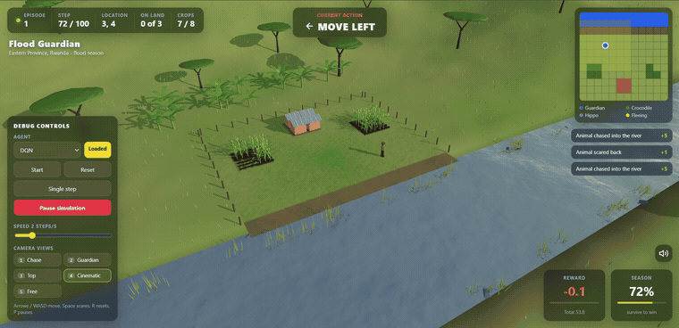
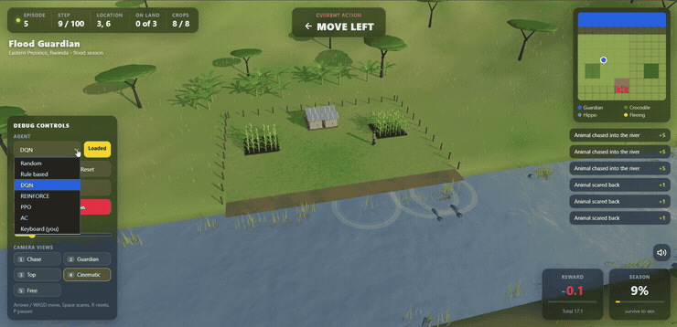
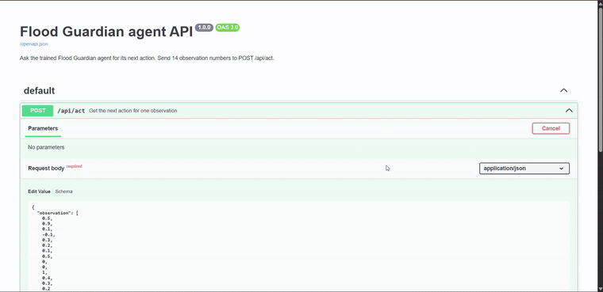
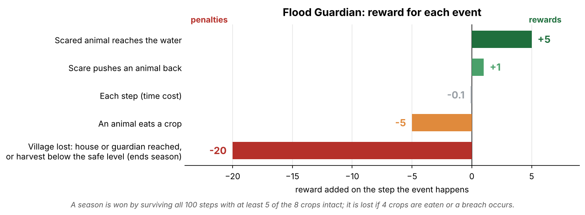
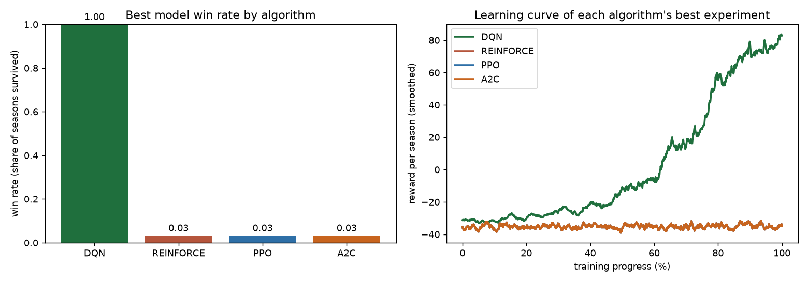
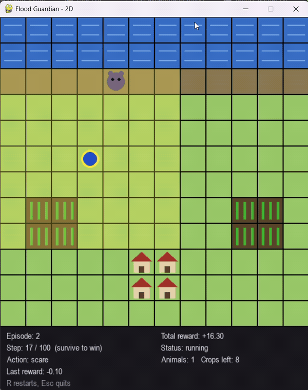

# Flood Guardian

A custom reinforcement learning environment and four trained agents, built for the Mission
Based Reinforcement Learning summative. The project trains DQN, REINFORCE, A2C and PPO on the
same game, compares them, and lets you watch any of the trained agents play in a 3D or 2D view.

[](https://youtu.be/cIg7Uhnmsw0)



## The mission

I grew up in a flood prone part of Rwanda, and this project turns a real problem from home into
a game an agent can learn.

- **Place.** A village in the Eastern Province of Rwanda, next to a river.
- **Problem.** Every flood season the river rises and pushes dangerous animals, crocodiles and
  hippos, out of the water. They walk toward the houses and the crops. If they reach a house or
  eat enough of the harvest, the season is lost.
- **The guardian.** One person walks around and scares the animals back to the river before they
  do harm. The agent learns to be that guardian: where to stand, and when to scare.

The wider goal fits my mission in agriculture and wildlife conservation: protect both the farmers
and the animals, by moving the animals away safely instead of harming them.

### Why reinforcement learning

A fixed rule like "always run to the nearest animal" can work, but it cannot weigh the trade offs
that make this hard: chase the animal near the crops now, or the one closer to a house; scare now,
or step one cell first so more animals are in range. The world keeps changing, the animals move
and rest at random, and a reward only arrives several steps after a good decision. Reinforcement
learning fits this, because the agent learns a policy from trial and error that plans over time,
instead of following one hand written rule. The environment is also too large for a lookup table:
the guardian, three animals, the crops and the clock all change at once, so the number of possible
situations is in the millions. That is why the agent reads a small set of numbers and a network
chooses the action, rather than memorizing a table like FrozenLake.

## What is in the repo

```
principie_cyubahiro_rl_summative/
  environment/
    custom_env.py          the game itself, a Gymnasium environment
    rendering.py           the 2D window and the 3D web viewer
    baseline.py            a hand written guardian, used as a reference
  training/
    common.py              shared helpers: the network, the greedy test, saving a run
    dqn_training.py        trains one DQN experiment
    reinforce_training.py  trains one REINFORCE experiment
    actor_critic_training.py   trains one A2C experiment
    ppo_training.py        trains one PPO experiment
  notebooks/               one notebook per algorithm, runs its ten experiments
  models/<algo>/exp<nn>/   every experiment: model.pth, history.csv, config.json, plot
  models/<algo>/best_model/   the best experiment of each algorithm, picked by greedy play
  logs/results_table.csv   the comparison table across all experiments
  select_best.py           picks the best model of an algorithm
  results_table.py         builds the comparison table
  plots.py                 draws the comparison charts for the report
  main.py                  the demo: watch an agent play in 2D or 3D
  play.py                  play the best trained agent straight away
  assets/                  the 3D web page, sounds and meshes
  tests/steps_check.py     a quick check of what is done and what is left
```

## Setup

The project uses uv and Python 3.11. From the project folder:

```
uv sync
```

That installs everything from `pyproject.toml` and `uv.lock` into a local `.venv`. After that,
every command is run with `uv run`, so you never activate a virtual environment by hand.

## Watch an agent play

The quickest way is `play.py`, which plays the best trained agent:

```
uv run play.py                     the best DQN agent, in the browser
uv run play.py --algo ppo          the best model of another algorithm
uv run play.py --view 2d           the 2D window instead of the browser
```

For more control, `main.py` opens the same 3D view but also loads random, rule based and
keyboard, and prints every step in the terminal.

```
uv run main.py                     all agents are loaded, random plays first
uv run main.py --mode dqn          start with the best DQN agent playing
uv run main.py --mode rule_based   the hand written guardian that wins
uv run main.py --mode keyboard     drive the guardian yourself with the arrow keys
uv run main.py --view 2d --mode dqn    the same, in a 2D pygame window
```

In the 3D view there is an agent picker in the top left. The best model of each algorithm is
loaded automatically, so the picker holds Random, Rule based, DQN, REINFORCE, PPO, AC and
Keyboard. Switch between them at any time and the guardian changes on the spot.



To add any of the other trained models, around forty of them across the experiments, pass
`--model`. It takes a short name, a folder, a full path, or your own name:

```
uv run main.py --model dqn/exp05
uv run main.py --model models/ppo/exp03/model.pth
uv run main.py --model fast=models/dqn/exp10
```

Each one you add shows up in the picker too. Keys in the 3D view: arrows or WASD move, space
scares, R resets, P pauses, and the number keys switch camera.

## How it fits together

The project is a simple pipeline, so any saved agent can be rebuilt and watched later.

- Serialization. Each trainer saves its network as a `model.pth` state dict, next to a
  `config.json` that records the hidden size and the evaluation scores. `select_best.py`
  replays every experiment with no exploration, ranks them by win rate and then average
  reward, and copies the winner into `models/<algo>/best_model/`. `main.py` and `play.py`
  rebuild the network from `config.json` and load the weights with `load_state_dict`, so the
  shapes always match.
- API. The 3D view runs a small local HTTP server with a JSON API that the web page calls:
  `GET /api/state` returns the current world, `POST /api/step` takes one step, `POST /api/reset`
  starts a new season, and `POST /api/agent` switches the agent. The Three.js front end in
  `assets/` reads these, so the browser and the Python environment stay in step.
- Terminal. Every step is also printed in the terminal (action, reward, running total and
  status), so the GUI and the terminal always tell the same story.

## Using the trained agent from other apps

While the viewer is running (`uv run play.py` or `uv run main.py`), the same server also serves
the trained agent over HTTP, so a dispatch dashboard or a mobile app could ask it what to do next:

The easiest way is the Swagger page. With the server running, open **http://localhost:8000/docs**,
expand `POST /api/act`, click **Try it out** and then **Execute**, and you get the agent's action back.



| Endpoint | Use |
|---|---|
| `GET /docs` | interactive Swagger page to try the API in the browser |
| `POST /api/act` | send the 14 observation numbers, get the next action back |
| `GET /api/act` | help: how to call it, with an example body |
| `GET /api/health` | check the server is up and which model is loaded |

Or call it from any language:

```bash
curl -X POST http://localhost:8000/api/act -H "Content-Type: application/json" \
     -d '{"observation": [0.5, 0.9, 0.1, -0.1, 0.3, 0.2, 0.1, 0.5, 0, 0, 1, 0.4, 0.3, 0.2]}'
```

```json
{"action": 4, "action_name": "scare", "scores": [-3.88, -2.26, -2.76, 1.55, 4.30]}
```

It serves the best model (DQN), rebuilt from its saved `model.pth` and `config.json`. (The Swagger
page loads its assets from a CDN, so `/docs` needs internet; the `curl` call works offline.)

## The environment

A 12 by 12 grid. The river and the safe water are rows 0 and 1, the flood edge is row 2, the
houses sit at the bottom and the crops are in two fields inland. The guardian starts just above
the houses. One game is one flood season of 100 steps.

### Action space (Discrete, 5 actions)

| Code | Action | What happens |
|------|--------|--------------|
| 0 | Up | Move one cell up, toward the river |
| 1 | Down | Move one cell down, toward the houses |
| 2 | Left | Move one cell left |
| 3 | Right | Move one cell right |
| 4 | Scare | Stay in place and scare every calm animal within 3 cells, sending it back to the river |

Moving into a grid edge or an animal does nothing but still costs a step. Scaring only helps when
a calm animal is in range, so the guardian has to walk up to an animal first, then scare it.

### Observation space (Box of 14 numbers)

The agent does not read raw pixels. It reads 14 numbers that describe the situation from the
guardian's point of view, all scaled to a small range so the network learns well. They answer
four questions:

| Index | Question | Values | Count |
|-------|----------|--------|-------|
| 0 to 1 | Where am I? My column and my row | 0 to 1 | 2 |
| 2 to 10 | Where are the animals? For each of the 3, nearest first: how far left or right, how far up or down, and the straight line distance | -1 to 1, and 0 to 1 for distance | 9 |
| 11 to 12 | How close are the things I protect? Distance to the nearest house and the nearest crop | 0 to 1 | 2 |
| 13 | How far into the season are we? | 0 to 1 | 1 |

An animal resting in the river is not visible: its three slots are filled with 0, 0, 1. The
observation is built by `observation()` in `custom_env.py` and refreshed after every step.

### Reward structure

| What happens | Reward |
|--------------|--------|
| Every step, whatever the agent does | -0.1 |
| A scare makes a calm animal run away | +1 |
| That animal reaches the river | +5 |
| An animal eats a crop | -5 |
| The village is lost (season ends) | -20 |

The guardian is not paid for standing near the village. It earns points only by chasing animals
away, and is punished when it fails, so it has to learn that getting close to the animals is what
pays. The step cost keeps it from wasting time.



### Start and end of a season

- **Start.** A fresh grid with 4 houses and 8 crops, the guardian just above the houses, and all
  3 animals climbing out of the river at random spots. The start is randomized so the agent cannot
  memorize one layout.
- **Win.** The season reaches step 100 with the village still safe.
- **Lose (ends at once with -20).** An animal reaches a house, an animal walks onto the guardian,
  or half the harvest (4 of 8 crops) is eaten.

In Gymnasium terms the episode ends with `terminated = True`, and `truncated` is always False. The
step limit is the win, not a time cut, and the agent can see the season progress, so it is a real
terminal state.

### How hard is it

The environment is genuinely hard, which is why learning matters. Over 300 seasons:

| Player | Seasons won | Average score |
|--------|-------------|---------------|
| Random actions | 0% | about -32 |
| Hand written rule based guardian | high | about 105, best 134 |
| Best trained DQN | about 95 to 100% | about 95 to 98 |

So random play never wins, and a good trained agent reaches the level of the hand written guardian
on its own.

## The four agents

All four are built with the TorchRL library and share the same small network (14 inputs, two
hidden layers, 5 outputs) and the same saving code, so the comparison is fair. Each is trained one
experiment at a time, for the same number of steps.

- **DQN**, value based. Learns a value for each action and picks the highest, with a replay buffer,
  a target network and epsilon greedy exploration.
- **REINFORCE**, policy based and Monte Carlo. Learns the policy directly from whole episodes, with
  a value baseline.
- **A2C**, actor critic. An actor that acts and a critic that scores states, so it learns from each
  step instead of waiting for the end of an episode.
- **PPO**, actor critic with a safety rule. Like A2C, but it updates several times on each batch and
  clips how far the policy may move in one step, which keeps it stable.

### What each one tunes

Ten experiments per algorithm, changing one setting at a time from a baseline, so the effect of
each is easy to read. The full settings and scores are in `logs/results_table.csv`.

| Algorithm | Settings explored |
|-----------|-------------------|
| DQN | learning rate, gamma, batch size, replay buffer size, epsilon decay, target update interval |
| REINFORCE | learning rate, gamma, rollout size, entropy bonus, GAE lambda, network size |
| A2C | learning rate, gamma, entropy bonus, rollout size, GAE lambda, network size |
| PPO | learning rate, gamma, clip range, update epochs, entropy bonus, network size |

## Training the agents

Open the notebook for an algorithm under `notebooks/` and run every cell from top to bottom, or
run a single experiment from the terminal:

```
uv run python training/dqn_training.py --exp 1 --lr 1e-3 --gamma 0.99
uv run python training/reinforce_training.py --exp 1
uv run python training/actor_critic_training.py --exp 1
uv run python training/ppo_training.py --exp 1
```

Each run trains one experiment, scores it by greedy play, and saves the model, the per episode
history, the settings and a reward plot under `models/<algo>/exp<nn>/`.

## Picking the best model and the table

After the ten experiments of an algorithm are done:

```
uv run python select_best.py --algo dqn       picks the best DQN model into models/dqn/best_model
uv run python results_table.py                builds logs/results_table.csv across all algorithms
```

A model is scored by greedy play: it plays a set of full seasons with no random moves, and we
report the average reward and the win rate, the share of seasons it survived. That is a fairer
measure than the training reward, which is noisy because of exploration.

## Results

The full table is in `logs/results_table.csv`. The short version:

- **DQN learns to protect the village.** Its best experiment wins nearly every season and earns a
  high positive reward by scaring animals back again and again, reaching the level of the hand
  written guardian.
- **The policy gradient agents, REINFORCE, A2C and PPO, do not win in this budget.** They improve on
  random play but settle into a weak habit, and their win rate stays near zero.

This gap is the interesting result, not a mistake. The task rewards learning the value of each
small step, which DQN does well through its replay buffer and bootstrapping. The policy gradient
methods explore only by sampling their own policy, and on a task where the guardian must first walk
to an animal before any reward arrives, that exploration is not enough within the same number of
steps. The report discusses this in full.

The comparison chart is made by a small script that reads the saved runs:

```
uv run python plots.py
```

It writes `docs/screenshots/results.png` (below), plus `win_rate.png` and `learning_curves.png` on
their own. Each single experiment also already has its own reward curve saved as `training_plot.png`
inside its `models/<algo>/exp<nn>/` folder.



## The 2D view

A fast 2D view shows the same game on a plain grid, useful for reading the board clearly:

```
uv run main.py --view 2d --mode dqn
```



## Reproducing everything

1. `uv sync`
2. Run the four notebooks in `notebooks/`, or the training commands above, to fill `models/`.
3. `uv run python select_best.py --algo dqn` (and reinforce, ppo, ac) to pick each best model.
4. `uv run python results_table.py` to rebuild the table, and `uv run python plots.py` for the charts.
5. `uv run main.py --mode dqn` to watch the best agent play.

The training is the same on a laptop or on Kaggle, since the network is small and the work is on
the CPU. Training does not open any viewer; the 3D view is only for watching an agent play.

## Notes

- `tests/steps_check.py` prints what is finished and what is left: `uv run python tests/steps_check.py`.
- The sounds in `assets/audio/` are short cues for the moves and the scare. The 3D meshes for the
  animals are in `assets/meshes/`.
- Seeds are fixed so a run can be repeated, though the game has a little built in randomness, so a
  single season can still vary by a point or two.